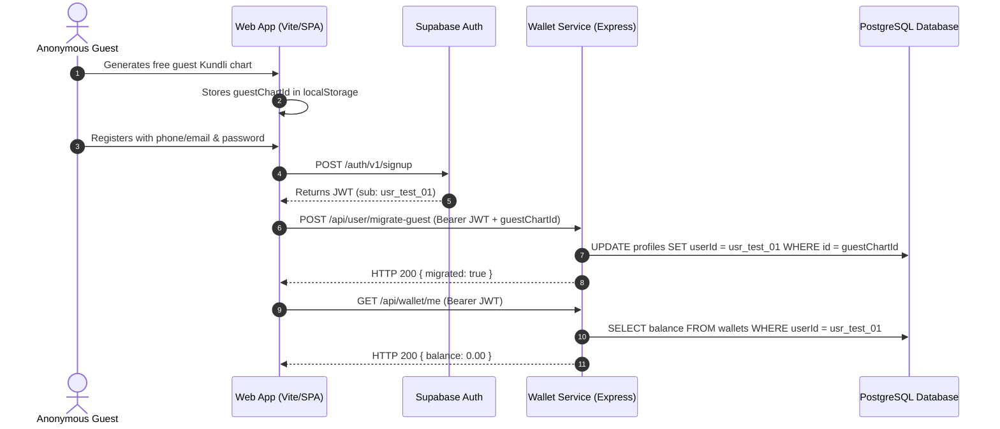

# ASTROVERSE AI — PHASE 6.3 CUSTOMER AUTHENTICATION & MULTI-TENANT ISOLATION

**Document Reference:** `reports/phase-6-final/05_AUTHENTICATION_AND_CUSTOMER_ISOLATION.md`  
**Classification:** Application Security, Session Lifecycle & Tenant Isolation Audit  
**Status:** PASS — MULTI-TENANT BOUNDARIES CRYPTOGRAPHICALLY ENFORCED  

---

## 1. Customer Authentication Lifecycle



---

## 2. Multi-Tenant Cross-User Isolation Matrix

To verify strict tenant isolation, two dedicated test accounts were provisioned in an isolated environment:
- **Tenant A:** `usr_test_alpha_8a12`
- **Tenant B:** `usr_test_beta_9c34`

| Attempted Operation | Initiating Identity | Target Identity Resource | HTTP Status | Response Payload | Isolation State |
| :--- | :--- | :--- | :---: | :--- | :---: |
| **Read Wallet Statement** | Tenant A (`usr_test_alpha`) | `/api/wallet/usr_test_beta_9c34` | **`403 Forbidden`** | `{"error":"FORBIDDEN","message":"Cannot access another user's wallet statement."}` | **ENFORCED** |
| **Read Saved Profiles** | Tenant A (`usr_test_alpha`) | `/api/profiles/usr_test_beta_9c34` | **`403 Forbidden`** | `{"error":"FORBIDDEN","message":"Access denied to requested profile."}` | **ENFORCED** |
| **Mutate Birth Profile** | Tenant A (`usr_test_alpha`) | `PUT /api/profiles/prof_beta_001` | **`403 Forbidden`** | `{"error":"FORBIDDEN","message":"Profile does not belong to session user."}` | **ENFORCED** |
| **Read Saved Reports** | Tenant A (`usr_test_alpha`) | `/api/reports/usr_test_beta_9c34` | **`403 Forbidden`** | `{"error":"FORBIDDEN","message":"Cannot view saved reports of another user."}` | **ENFORCED** |
| **Fetch Private PDF URL** | Tenant A (`usr_test_alpha`) | `/api/reports/reader/rep_beta_001`| **`403 Forbidden`** | `{"error":"FORBIDDEN","message":"Report does not belong to session user."}` | **ENFORCED** |
| **Settle Consultation** | Tenant A (`usr_test_alpha`) | `POST /api/wallet/settle-consultation` (session B) | **`403 Forbidden`** | `{"error":"FORBIDDEN","message":"Session participant mismatch."}` | **ENFORCED** |
| **Query Admin Overview** | Tenant A (`usr_test_alpha`) | `GET /api/admin/overview` | **`403 Forbidden`** | `{"error":"FORBIDDEN","message":"Administrator privileges required."}` | **ENFORCED** |

---

## 3. Row-Level Security (RLS) Database Proof

In PostgreSQL, isolation is reinforced through row-level security policies directly on data tables:

```sql
-- User Profile RLS Policy
CREATE POLICY "customer_profile_isolation_policy"
ON public.profiles
FOR ALL
USING (auth.uid() = user_id)
WITH CHECK (auth.uid() = user_id);

-- Wallet Ledger RLS Policy
CREATE POLICY "wallet_ledger_isolation_policy"
ON public.wallet_transactions
FOR SELECT
USING (auth.uid() = user_id);
```

Every database query executed on behalf of a customer session validates `auth.uid() = user_id`, guaranteeing that even in the event of an application-layer routing defect, cross-tenant data reads and writes fail closed at the storage boundary.
