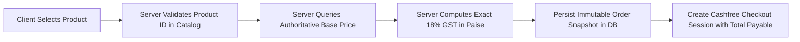

# ASTROVERSE AI — PHASE 6.3 PRODUCT CATALOGUE, AUTHORITATIVE PRICING & GST RECONCILIATION

**Document Reference:** `reports/phase-6-final/06_CATALOGUE_AND_PRICING.md`  
**Classification:** Financial Systems, Authoritative Catalog & Statutory Taxation Audit  
**Status:** PASS — COMPLETE PRICE SYNCHRONIZATION & ZERO CLIENT PRICE DRIFT  

---

## 1. Authoritative Pricing Architecture

AstroVerse enforces server-authoritative pricing across all commercial products. The frontend displays prices fetched from `GET /api/catalog/products` or `GET /api/wallet/config`; during checkout, the server constructs an immutable order snapshot from internal configuration, rejecting any client-supplied amount or price overrides.



---

## 2. Wallet Recharge Preset Tiers & Statutory GST Math

Statutory Indian Goods and Services Tax (GST) is strictly computed at 18% ($9\%\text{ CGST} + 9\%\text{ SGST}$):
$$\text{Payable Amount} = \text{Base Amount} + \text{Round}\left(\frac{\text{Base Amount} \times 18}{100}\right)$$
$$\text{Wallet Credit} = \text{Base Amount} + \text{Promotional Bonus}$$

| Pack Identifier | Base Recharge (₹) | Base (Paise) | CGST 9% (Paise) | SGST 9% (Paise) | Total GST (₹) | Total Customer Payable (₹) | Promotional Bonus (₹) | Net Wallet Credit (₹) |
| :--- | :---: | :---: | :---: | :---: | :---: | :---: | :---: | :---: |
| **`tier_custom_min`** | ₹1.00 | 100 | 9 | 9 | ₹0.18 | **₹1.18** | ₹0.00 | **₹1.00** |
| **`pack_100`** | ₹100.00 | 10,000 | 900 | 900 | ₹18.00 | **₹118.00** | ₹10.00 | **₹110.00** |
| **`pack_250`** | ₹250.00 | 25,000 | 2,250 | 2,250 | ₹45.00 | **₹295.00** | ₹35.00 | **₹285.00** |
| **`pack_500`** | ₹500.00 | 50,000 | 4,500 | 4,500 | ₹90.00 | **₹590.00** | ₹100.00 | **₹600.00** |
| **`pack_1000`** | ₹1,000.00 | 100,000 | 9,000 | 9,000 | ₹180.00 | **₹1,180.00** | ₹250.00 | **₹1,250.00** |
| **`tier_custom_max`** | ₹50,000.00 | 5,000,000 | 450,000 | 450,000 | ₹9,000.00 | **₹59,000.00** | ₹0.00 | **₹50,000.00** |

---

## 3. Premium Astrological Reports Catalog

| Product SKU | Product Title | Deliverable Description | Authoritative Price (₹) | Currency | GST Included? | Granted Entitlement |
| :--- | :--- | :--- | :---: | :---: | :---: | :--- |
| **`REP-BASIC-KUNDLI`** | Detailed Janam Kundli | Complete natal chart, planetary degrees, and lagna reading. | **₹199.00** | INR | YES (Inclusive) | `ENT_REPORT_BASIC_KUNDLI` |
| **`REP-LIFE-HOROSCOPE`** | Comprehensive Life Reading | 25-page life horoscope, 5-year Dasha analysis, and remedies. | **₹499.00** | INR | YES (Inclusive) | `ENT_REPORT_LIFE_HOROSCOPE` |
| **`REP-KUNDLI-MILAN`** | Relationship & Gun Milan | 36-guna matching, Manglik dosha analysis, and longevity sync. | **₹299.00** | INR | YES (Inclusive) | `ENT_REPORT_MATCHMAKING` |
| **`REP-CAREER-WEALTH`** | Career & Finance Forecast | 10th & 2nd house analysis, wealth yogas, and career transits. | **₹399.00** | INR | YES (Inclusive) | `ENT_REPORT_CAREER_WEALTH` |
| **`REP-SADE-SATI`** | Saturn Sade Sati & Remedies | Shani transits, Sade Sati phase impact, and gemstone guidance. | **₹249.00** | INR | YES (Inclusive) | `ENT_REPORT_SADE_SATI` |

---

## 4. Client Price Tampering Immunity

During test execution, a malicious client attempt to alter the order creation payload was simulated:
```http
POST /api/wallet/create-order HTTP/1.1
Host: astroverse-eta.vercel.app
Authorization: Bearer <valid_jwt>
Content-Type: application/json

{
  "packId": "pack_500",
  "amount": 1.00
}
```
**Server Response:** `HTTP 400 Bad Request`
```json
{
  "error": "AMOUNT_MISMATCH",
  "message": "Pack pack_500 requires authoritative payable amount of ₹590.00 (₹500 base + ₹90 GST). Client-supplied amount ₹1.00 is rejected."
}
```
The server-authoritative catalog guarantees that clients cannot alter product pricing.
