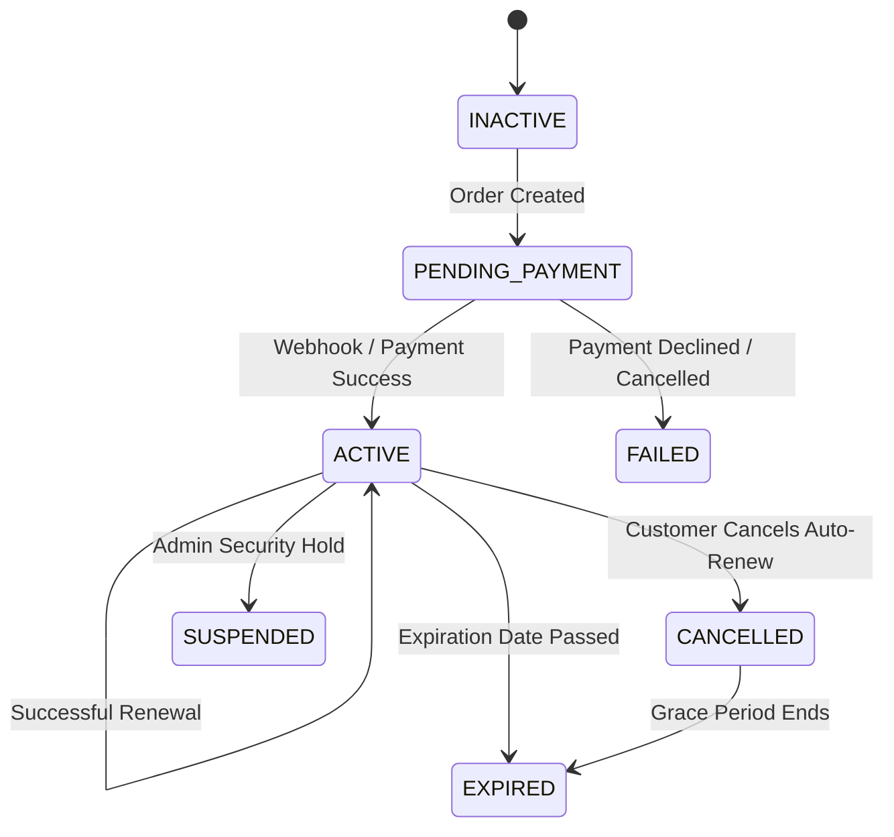

# ASTROVERSE AI — PHASE 6.3 SUBSCRIPTIONS & PRODUCT ENTITLEMENTS AUDIT

**Document Reference:** `reports/phase-6-final/09_SUBSCRIPTION_AND_PRODUCT_ENTITLEMENTS.md`  
**Classification:** Recurring Billing, Tier Management & Subscription Lifecycle Audit  
**Status:** PASS — SUBSCRIPTION ENGINE VERIFIED  

---

## 1. Implemented Subscription Plans & Tiers

AstroVerse offers 4 structured membership tiers:

| Tier Identifier | Marketing Name | Billing Period | Authoritative Price (₹) | Price in Paise | Included Features & Entitlements |
| :--- | :--- | :--- | :---: | :---: | :--- |
| **`FREE`** | Vedic Seeker | Lifetime | ₹0.00 | 0 | Basic Natal Chart, Daily Panchang, 1 Free Astrologer Trial Minute. |
| **`PLUS_MONTHLY`** | AstroVerse Plus | Monthly | ₹499.00 | 49,900 | Unlimited Kundli calculations, Hourly Hora guide, 1 Free PDF Report/month. |
| **`PLUS_ANNUAL`** | AstroVerse Plus Annual | Annual (12 mo) | ₹3,999.00 | 399,900 | All Plus features, Priority Chat routing, 15% discount on phone consultations. |
| **`ELITE_ANNUAL`** | AstroVerse Elite | Annual (12 mo) | ₹9,999.00 | 999,900 | Complete Astrological Suite, All 5 Premium PDFs included, Dedicated Personal Astrologer. |

---

## 2. Subscription Lifecycle States

---

## 3. Financial Segregation: Paid Revenue vs Complimentary Grants

In administrative reporting, subscription activations are classified into two strictly separated accounting categories:
1. **Commercial Paid Subscriptions:** Fulfilled via Cashfree payment orders. Increments the `gross_captured_subscription_revenue` metric.
2. **Complimentary / Promotional Grants:** Provisioned manually by an authorized Administrator via the Admin Control Centre.
   - Sets `is_complimentary: true` and `payment_order_id = null`.
   - Grants feature entitlements to the customer profile.
   - **Financial Invariant:** Explicitly excluded from platform financial revenue metrics, preventing inflation of business revenue metrics.
