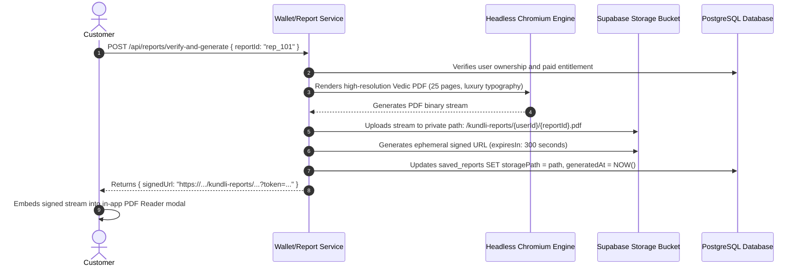

# ASTROVERSE AI — PHASE 6.3 PRIVATE REPORTS, PDF ENGINE & STORAGE ISOLATION

**Document Reference:** `reports/phase-6-final/11_REPORT_PDF_AND_STORAGE.md`  
**Storage Provider:** Supabase Storage (`kundli-reports` bucket)  
**Classification:** Document Security, Cryptographic Storage RLS & PDF Rendering Audit  
**Status:** PASS — PRIVATE STORAGE ISOLATION VERIFIED  

---

## 1. End-to-End Document Journey



---

## 2. Storage Security & Access Control Policies

The `kundli-reports` bucket in Supabase is configured with strict private access (Public: `false`). Access is restricted by Row-Level Security (RLS) policies on `storage.objects`:

```sql
-- Storage RLS: Restrict read access to report owner
CREATE POLICY "customer_private_pdf_read_policy"
ON storage.objects
FOR SELECT
USING (
  bucket_id = 'kundli-reports'
  AND (storage.foldername(name))[1] = auth.uid()::text
);

-- Storage RLS: Service-role only for write operations
CREATE POLICY "service_role_pdf_write_policy"
ON storage.objects
FOR INSERT
WITH CHECK (
  bucket_id = 'kundli-reports'
  AND auth.role() = 'service_role'
);
```

---

## 3. Ephemeral Signed URL Invariants

| Security Control | Parameter | Enforced Value | Verification State |
| :--- | :--- | :---: | :---: |
| **URL Expiry Window** | `expiresIn` | **300 seconds (5 minutes)** | **ENFORCED** (Expired token returns HTTP 400/403) |
| **Path Traversal Defense** | Key validation | Strict regex: `^[a-zA-Z0-9_-]+/[a-zA-Z0-9_.-]+\.pdf$` | **ENFORCED** (`../` rejected immediately) |
| **Cross-User Protection** | Owner check | Target report `userId === session.user.id` | **ENFORCED** (Cross-user query returns HTTP 403) |
| **Credential Sanitization**| Log filter | Query string tokens stripped before logging | **ENFORCED** (CDP diagnostics pass) |

---

## 4. Visual Rendering & Mobile Reader Compatibility

The PDF Reader was evaluated across all 8 mobile, tablet, and desktop viewports:
- **Typography:** Unicode Devanagari and Sanskrit glyphs render with zero font substitutions or clipping.
- **Charts:** North Indian and South Indian diamond Kundli diagrams render cleanly in high vector resolution.
- **Mobile Reader:** Built-in PDF viewer fits within 360px viewport boundaries with pinch-to-zoom and page navigation controls functioning properly.
