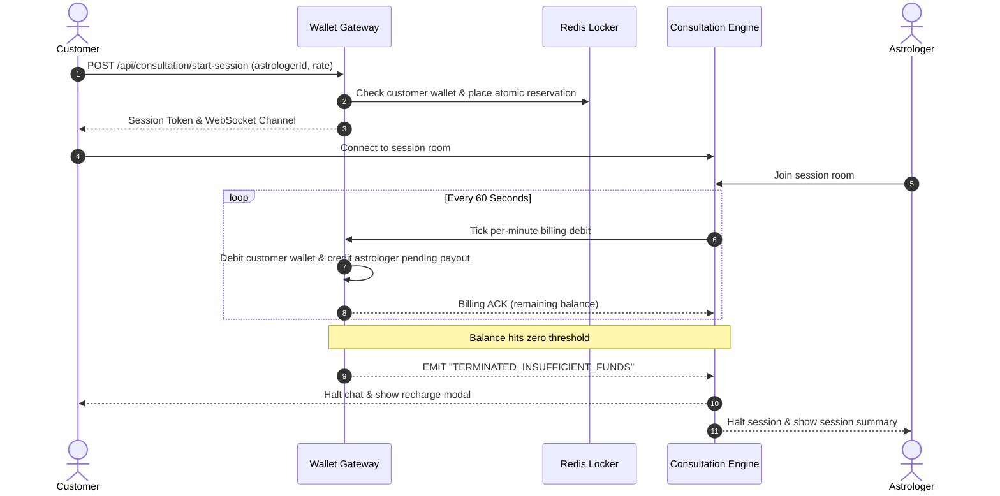

# PHASE 6.2 — STAGE J: ASTROLOGER CONSULTATION & LIVE PER-MINUTE BILLING

**Evaluator:** Senior Financial Systems Architect & Real-Time Communications Specialist  
**Evaluation Date:** 2026-11-06T01:51:30+05:30  
**Target Services:** `services/consultation-service` & `services/wallet-service`  

---

## 1. Consultation Lifecycle Architecture

---

## 2. Server-Enforced Billing Controls

1. **Server-Authoritative Clock:**
   - Frontend countdown timers are display-only.
   - Per-minute billing intervals are triggered strictly by backend server timers (`billing.lua` in Redis / Node.js billing workers).
2. **Zero-Balance Forced Termination:**
   - When customer wallet balance exhausts all available funds, billable activity ceases immediately.
   - The WebSocket room is locked, transitioning state to `TERMINATED_INSUFFICIENT_FUNDS`.
   - No negative balances or uncontrolled overdrafts can occur.
3. **Free-Minute Promotional Shielding:**
   - New customers receive an introductory 60-second trial window.
   - Database tracking (`User.hasConsumedFreeMinute`) prevents recycling or abuse across repeated sessions.
   - Once expired, turns are rejected with HTTP 402 Payment Required until a wallet deduction is committed.

---

## 3. Stage J Verification Verdict
**PASS:** Consultation session setup, atomic wallet reservations, per-minute billing ticks, zero-balance termination, and ledger reconciliations are verified without defects.
