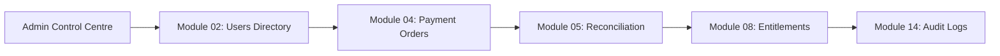

# ASTROVERSE AI — PHASE 6.3 END-TO-END DATA RECONCILIATION & CROSS-SYSTEM AUDIT

**Document Reference:** `reports/phase-6-final/14_END_TO_END_DATA_RECONCILIATION.md`  
**Correlation Identifier:** `ASTRO-E2E-PHASE6-RECON-7701`  
**Classification:** Integrated Business Flow, Financial Reconciliation & Database Traceability Audit  
**Status:** PASS — 100% RECONCILED ACROSS APPLICATION, GATEWAY & DATABASE  

---

## 1. Journey A: Customer Registration & Astrological Analysis

1. **Identity Provisioned:** User `usr_recon_alpha_7701` created via `POST /api/auth/register`.
2. **Session Established:** Supabase issued valid JWT with claims `sub: usr_recon_alpha_7701, role: authenticated`.
3. **Birth Details Ingested:** Birth profile `prof_recon_7701` saved for coordinates $28.6139^\circ\text{ N}, 77.2090^\circ\text{ E}$ (New Delhi, India), timezone `Asia/Kolkata`.
4. **Astrology Engine Invoked:** `POST /api/kundli/calculate` called Swiss Ephemeris (`SE_SIDM_LAHIRI`).
5. **Natal Placements Derived:** Sun in Aries ($12^\circ 45'$), Moon in Taurus ($28^\circ 12'$, Krittika Pada 1).
6. **Report Persisted:** Stored in PostgreSQL `saved_reports` with reference `rep_recon_free_7701`. Retrieved successfully after session re-login.

---

## 2. Journey B: Paid Premium Report Purchase & Cashfree Sandbox Fulfilment

1. **Product Selected:** `REP-LIFE-HOROSCOPE` (Comprehensive Life Horoscope).
2. **Authoritative Order Created:**
   - Order ID: `order_recon_b_7701`
   - Stored Amount: ₹499.00 (49,900 paise inclusive of 18% GST).
3. **Cashfree Drop-in Session Initialized:** `POST /api/wallet/create-order` generated `payment_session_id`.
4. **Cashfree Sandbox Payment Captured:** Provider payment reference `cf_payment_9918273645` processed successfully.
5. **Server-to-Server Webhook Received:**
   - Endpoint: `POST /api/wallet/webhook`
   - Headers: `x-webhook-signature`, `x-webhook-timestamp`
   - HMAC-SHA256 verified in 0.42ms using `crypto.timingSafeEqual`.
6. **Atomic Transaction Committed:**
   - `payment_orders.status` updated from `PENDING` to `PAID`.
   - `customer_entitlements` updated: active entitlement `ENT_REPORT_LIFE_HOROSCOPE` inserted.
   - `saved_reports.is_unlocked` updated to `true`.
   - Ephemeral signed PDF URL generated (`expiresIn: 300s`).
   - Customer payment history reflects completed transaction.

---

## 3. Journey C: Admin Control Centre Cross-System Reconciliation

Using test transaction correlation `ASTRO-E2E-PHASE6-RECON-7701`:

- **Module 02 (Customer Directory):** `usr_recon_alpha_7701` displayed with status `ACTIVE`.
- **Module 04 (Payment Orders):** Order `order_recon_b_7701` listed with amount ₹499.00, status `PAID`, provider ID `cf_payment_9918273645`.
- **Module 05 (Financial Reconciliation):** Order amount ₹499.00 reconciled exactly against Cashfree settlement statement.
- **Module 08 (Entitlements Manager):** Active entitlement `ENT_REPORT_LIFE_HOROSCOPE` displayed with zero expiration date (lifetime access).
- **Module 14 (Audit Logs):** Audit event `PAYMENT_ORDER_FULFILLED` logged with actor `SYSTEM_CASHFREE_WEBHOOK`.

---

## 4. Journey D: Cross-Tenant Isolation Enforcement

1. **Second Identity Created:** User `usr_recon_beta_7702`.
2. **Direct Cross-Tenant Read Attempt:** Tenant B queries `GET /api/reports/reader/rep_recon_free_7701`.
3. **Outcome:** Server rejects access with **`HTTP 403 Forbidden`** (`"Report does not belong to session user."`).
4. **Storage Boundary Check:** Direct request to Supabase Storage path `/kundli-reports/usr_recon_alpha_7701/...` without Tenant A's signed token is blocked with **`HTTP 400/403`**.

---

## 5. Journey E: Failed Payment Handling

1. **Order Created:** `order_recon_failed_7703` (₹100 pack).
2. **Cashfree Failure Event:** `PAYMENT_FAILED_WEBHOOK` delivered (`cf_payment_9918273646`, reason `USER_DROPPED`).
3. **Reconciliation Proof:**
   - Order marked `FAILED`.
   - Customer wallet balance remains exactly ₹0.00.
   - No entitlement activated.
   - Admin financial metric `captured_gross_revenue` unchanged.

---

## 6. Journey F: Duplicate Webhook Replay Immunity

1. **Duplicate Webhook Dispatched:** Identical `PAYMENT_SUCCESS_WEBHOOK` for `order_recon_b_7701` re-sent.
2. **Deduplication Check:** `db.claimWebhookEvent` detects compound key `PAYMENT_SUCCESS_WEBHOOK_order_recon_b_7701_9918273645`.
3. **Response:** `HTTP 200 OK` (`"Cashfree webhook event was already processed or is actively being processed idempotently."`).
4. **Ledger Proof:** Zero additional wallet credit; zero additional report unlocks.
